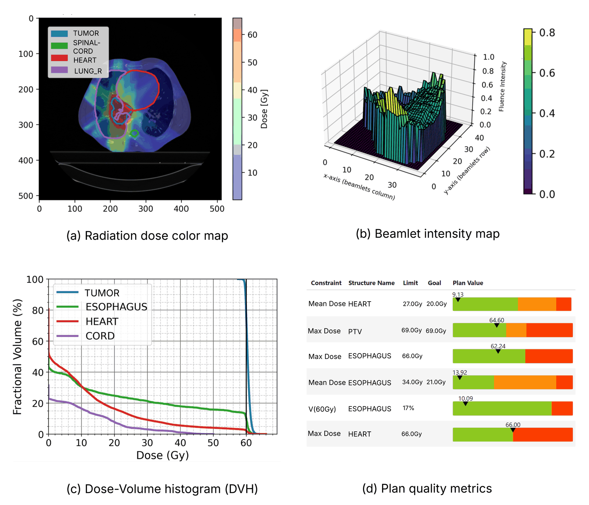
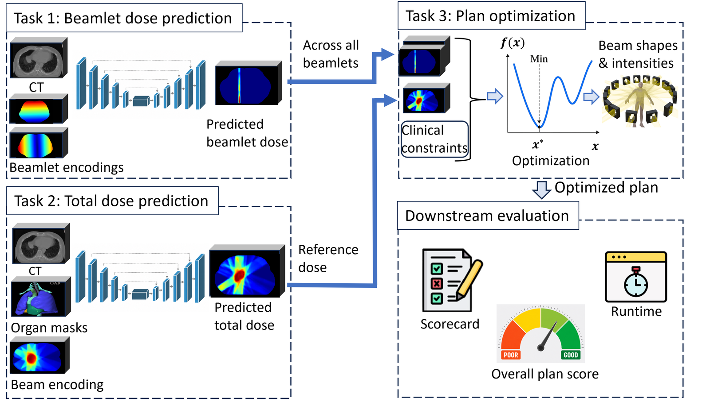

<p align="center">
  
</p>

<h3 align="center"><ins>P</ins>lanning and <ins>O</ins>ptimization for <ins>R</ins>adiation <ins>T</ins>herapy in <ins>Py</ins>thon (PortPy)</h3>

<p align="center">
<a href="https://pepy.tech/project/portpy"></a>
<a href="https://pepy.tech/project/portpy"></a>
<a href="#citing-portpy"></a>
  <a href="https://portpy-project.github.io/portpy.github.io/"></a>
  <a href="https://huggingface.co/datasets/PortPy-Project/PortPy_Dataset"></a>
   
</p>

<p align="center">
  <a href="https://portpy-project.github.io/portpy.github.io/">Documentation</a> ·
  <a href="#quickstart">Quickstart</a> ·
  <a href="#examples">Examples</a> ·
  <a href="#portpyai-benchmark">PortPy.AI benchmark</a> ·
  <a href="#data">Data</a> ·
  <a href="#citing-portpy">Paper</a>
</p>


**PortPy** is an open-source Python platform for **cancer radiotherapy treatment-planning research**.
Radiotherapy treats roughly half of all cancer patients by aiming high-energy beams at a tumor
from many directions. As the animation illustrates, the treatment machine (a linear accelerator)
rotates around the patient and delivers radiation from different angles, while a device mounted in
the head of the machine, the multi-leaf collimator (MLC), moves its metal leaves to shape and
modulate each beam. Choosing the shape, angle and intensity of those beams for each patient is a
large-scale, multi-criteria, often non-convex optimization problem.

PortPy gives researchers in **medical physics, mathematical optimization and AI/ML** a common,
clinically grounded playground: [real patient data](#data) with everything needed to optimize a
plan (**200 lung and 129 prostate patients**, more than 8 TB), reference algorithms that are used
clinically (e.g., [IMRT fluence-map optimization](https://github.com/PortPy-Project/PortPy/blob/master/examples/1_basic_tutorial.ipynb),
[VMAT direct aperture optimization](https://github.com/PortPy-Project/PortPy/blob/master/examples/vmat_scp_tutorial.ipynb)), AI baselines (e.g.,
deep-learning [beamlet dose prediction](https://github.com/PortPy-Project/PortPy/blob/master/examples/beamlet_dose_prediction.ipynb) and
[total dose prediction](https://github.com/PortPy-Project/PortPy/blob/master/examples/imrt_dose_prediction.ipynb)), and tools to
[evaluate a plan](#examples).


<br clear="right">

## Why PortPy?

- **Clinically realistic data.** Beamlet-to-voxel dose matrices (also called dose-influence or
  *dij* matrices) computed by the clinically commissioned Varian Eclipse treatment planning system
  (TPS), together with expert-selected beams, clinical criteria and expert reference plans (IMRT for
  every patient, VMAT for prostate), for **329 patients** (**200 lung, 129 prostate**).
- **Eclipse integration.** Eclipse users can
  [bring their own patients](https://github.com/PortPy-Project/PortPy/blob/master/examples/eclipse_photon_dose_calculation.ipynb):
  Varian's open-source [Eclipse Scripting API (ESAPI) tool](https://github.com/Varian-MedicalAffairsAppliedSolutions/MAAS-DoseInfluenceMatrix),
  developed in collaboration with the PortPy team, exports beamlets, voxels and dose-influence
  matrices directly in PortPy format. In the other direction, PortPy exports IMRT plans as
  Eclipse-compatible [optimal fluence](https://github.com/PortPy-Project/PortPy/blob/master/examples/imrt_tps_import.ipynb)
  that Eclipse imports for leaf sequencing and final dose calculation. Alternatively, PortPy writes
  DICOM-RT plans, including the leaf motions, for both
  [IMRT](https://github.com/PortPy-Project/PortPy/blob/master/examples/imrt_tps_import.ipynb) and
  [VMAT](https://github.com/PortPy-Project/PortPy/blob/master/examples/vmat_tps_import.ipynb), which
  any TPS can import.
- **Deliverable plans.** PortPy models the actual multi-leaf collimator (MLC) and exports IMRT and
  VMAT plans as [DICOM-RT](https://github.com/PortPy-Project/PortPy/blob/master/examples/imrt_tps_import.ipynb),
  so a plan can be imported into a clinical TPS and recalculated with only small dose differences.
- **Clinically deployed algorithms.** The fluence-map IMRT and VMAT optimizers are the engines of
  MSK's in-house automated planning systems,
  [ECHO-IMRT](https://aapm.onlinelibrary.wiley.com/doi/epdf/10.1002/mp.13572) and
  [ECHO-VMAT](https://iopscience.iop.org/article/10.1088/1361-6560/ace09e), which together have
  planned more than 14,000 patients as of October 2026.
- **Global-optimality references.** Mixed-integer formulations for [VMAT](https://github.com/PortPy-Project/PortPy/blob/master/examples/vmat_global_optimal.ipynb),
  [IMRT](https://github.com/PortPy-Project/PortPy/blob/master/examples/imrt_global_optimal.ipynb), [beam orientation](https://github.com/PortPy-Project/PortPy/blob/master/examples/beam_orientation_global_optimal.ipynb)
  and [DVH constraints](https://github.com/PortPy-Project/PortPy/blob/master/examples/dvh_constraint_global_optimal.ipynb)
  provide globally optimal solutions that are slow to compute but serve as an exact reference for
  benchmarking fast heuristic algorithms.
- **An end-to-end AI benchmark.** [PortPy.AI](#portpyai-benchmark) defines three tasks (beamlet-dose
  prediction, total-dose prediction, plan optimization) with frozen data splits, baselines, and an
  evaluation protocol that scores the *final deliverable plan*, not just the prediction.
- **Solver-agnostic.** Optimization problems are written in
  [CVXPY](https://www.cvxpy.org/), so solvers can be swapped in one line: commercial
  [MOSEK](https://www.mosek.com/) and [Gurobi](https://www.gurobi.com/) (free academic licenses)
  or open-source [SCS](https://www.cvxgrp.org/scs/) and [Clarabel](https://clarabel.org/), among
  [others](https://www.cvxpy.org/tutorial/solvers/index.html). *Coming soon:* our own
  open-source optimization engine, already in clinical use at MSK, which runs more than 2x faster
  than commercial solvers on CPU and also supports GPU. 

## Quickstart

The best place to start is the
[basic tutorial notebook](https://github.com/PortPy-Project/PortPy/blob/master/examples/1_basic_tutorial.ipynb),
which walks through every step below and explains the objects involved. Installation options,
including solvers, are [below](#installation). The condensed version:

```bash
pip install "portpy[data]"
```

```python
import portpy.photon as pp

# ---- 1. Load a patient (first call downloads ~2 GB from Hugging Face) ------------
data = pp.DataExplorer(hf_repo_id="PortPy-Project/PortPy_Dataset", local_download_dir="./portpy_data")
data.patient_id = "Lung_Patient_3"
data.filter_and_download_hf_dataset()
ct, structs, beams = pp.CT(data), pp.Structures(data), pp.Beams(data)

# ---- 2. Build the plan from a clinical protocol ----------------------------------
protocol = "Lung_2Gy_30Fx"
criteria = pp.ClinicalCriteria(data, protocol_name=protocol)      # dose limits the plan must meet
opt_params = data.load_config_opt_params(protocol_name=protocol)  # objectives, constraints, weights
structs.create_opt_structures(opt_params=opt_params, clinical_criteria=criteria)
inf_matrix = pp.InfluenceMatrix(ct=ct, structs=structs, beams=beams)  # dose = inf_matrix @ fluence
plan = pp.Plan(ct=ct, structs=structs, beams=beams, inf_matrix=inf_matrix, clinical_criteria=criteria)

# ---- 3. Optimize the IMRT fluence map (any CVXPY solver) -------------------------
opt = pp.Optimization(plan, opt_params=opt_params, clinical_criteria=criteria)
opt.create_cvxpy_problem()   # add your own objectives and constraints here, in CVXPY syntax
sol = opt.solve(solver="SCS")   # SCS is free but slow; MOSEK is much faster (free academic license)
# Coming soon: PortPy's own open-source optimization engine, faster than commercial solvers.

# ---- 4. Evaluate: DVH, dose on a CT slice, clinical scorecard --------------------
pp.Visualization.plot_dvh(plan, sol=sol, struct_names=["PTV", "CORD", "ESOPHAGUS", "LUNGS_NOT_GTV"])
pp.Visualization.plot_2d_slice(my_plan=plan, sol=sol, slice_num=60, struct_names=["PTV", "CORD"])
pp.Evaluation.display_clinical_criteria(plan, sol=sol, clinical_criteria=criteria)
```

<p align="center">
  
</p>
<p align="center"><em>What PortPy gives back: (a) dose overlaid on the CT, (b) a beam's fluence map, (c) dose-volume histograms, (d) a colour-coded clinical scorecard.</em></p>

## Examples

PortPy ships with more than 15 Jupyter notebooks in
[`examples/`](https://github.com/PortPy-Project/PortPy/tree/master/examples) (plain `.py` versions in
[`examples/python_files/`](https://github.com/PortPy-Project/PortPy/tree/master/examples/python_files))
that walk through most of its features; the
[examples guide](https://github.com/PortPy-Project/PortPy/blob/master/examples/README.md) groups them
by topic and lists what each one needs. Six good entry points:

| Notebook | Topic | What you learn |
|---|---|---|
| [1_basic_tutorial](https://github.com/PortPy-Project/PortPy/blob/master/examples/1_basic_tutorial.ipynb) |  | Load a patient, create an IMRT plan, visualize and evaluate it |
| [vmat_scp_tutorial](https://github.com/PortPy-Project/PortPy/blob/master/examples/vmat_scp_tutorial.ipynb) |  | VMAT planning with direct aperture optimization, exported as DICOM-RT |
| [imrt_dose_prediction](https://github.com/PortPy-Project/PortPy/blob/master/examples/imrt_dose_prediction.ipynb) |   | Predict a patient's 3D dose with a deep-learning model and turn it into a deliverable IMRT plan by dose mimicking |
| [beamlet_dose_prediction](https://github.com/PortPy-Project/PortPy/blob/master/examples/beamlet_dose_prediction.ipynb) |   | Predict beamlet-to-voxel doses (the dose-influence matrix) with a 3D U-Net, assemble the predicted matrix, and plan with it |
| [vmat_global_optimal](https://github.com/PortPy-Project/PortPy/blob/master/examples/vmat_global_optimal.ipynb) |  | Globally optimal VMAT plan from a mixed-integer program, as a reference for the fast heuristics |
| [imrt_tps_import](https://github.com/PortPy-Project/PortPy/blob/master/examples/imrt_tps_import.ipynb) |  | Export a plan as DICOM-RT or Eclipse fluence, import it into a TPS, and compare the recalculated dose |

Eclipse users who want to plan their own patients should start with
[eclipse_photon_dose_calculation](https://github.com/PortPy-Project/PortPy/blob/master/examples/eclipse_photon_dose_calculation.ipynb). The notebooks use
MOSEK by default; any CVXPY solver works for the convex problems, and the two dose-prediction
notebooks need a GPU and `pip install "portpy[ai]"`.

## PortPy.AI benchmark

<p align="center">
  
</p>

AI-based treatment planning has shown real promise, but progress has been slowed by three
obstacles: training data that is small, private and cannot be shared, evaluation criteria that differ
from one study to the next, and metrics that measure the accuracy of a prediction rather than the
quality of the plan a clinic could deliver. **PortPy.AI**
([NeurIPS 2026, Evaluations and Datasets Track](#citing-portpy)) tackles all three: a shared
public dataset with frozen train/validation/test splits, standardized clinical criteria for
evaluation, and scoring of the *final deliverable plan* rather than the intermediate prediction.
The figure above shows how its three tasks fit together. **Task 1** predicts the dose of each
beamlet from the patient's anatomy and the beamlet geometry, replacing the computationally expensive
physics-based dose calculation; PortPy.AI provides three baseline models for it (3D U-Net, 3D ViT,
3D Swin UNETR). **Task 2** predicts the total dose from the patient's anatomy, structure masks and
beam geometry, learning the trade-off between tumor coverage and healthy-organ sparing from previous
treatments; its three baselines are the top three performers of the
[AAPM GDP-HMM challenge](https://github.com/RiqiangGao/GDP-HMM_AAPMChallenge). **Task 3** takes both
predictions as inputs and optimizes a deliverable plan; PortPy offers a range of optimization
engines as baselines (e.g., fluence-map optimization, direct aperture optimization). Every task is
scored downstream, on the plan it leads to, against the clinical criteria.

Pretrained models and reference optimization solutions are published separately in
[PortPy-Project/artifacts](https://github.com/PortPy-Project/artifacts) and can be fetched with
`pp.download_artifact(...)`.

## Data

The benchmark dataset is hosted on Hugging Face:
[**PortPy-Project/PortPy_Dataset**](https://huggingface.co/datasets/PortPy-Project/PortPy_Dataset).
The original CT images and contours come from two public, de-identified TCIA collections,
[NSCLC-Radiomics](https://www.cancerimagingarchive.net/collection/nsclc-radiomics/) (lung) and
[Prostate-Anatomical-Edge-Cases](https://doi.org/10.7937/QSTF-ST65) (prostate). We imported them into
Eclipse and extracted everything needed for treatment planning, including:

1. **DICOM files** – CT images, structure set, RT dose and RT plans (IMRT for every patient, VMAT for prostate)
2. **Beamlet-to-voxel dose matrix** (also known as the dose-influence matrix) – dose contribution of
   every beamlet to every voxel, for 72 candidate beams
3. **Beamlet and voxel geometry** – positions and sizes, CT and structure masks
4. **Expert-selected beams** – the beam arrangement a clinical physicist chose for the patient
5. **Reference plans** – deliverable IMRT plans for every patient from MSK's automated planning system
   [ECHO-IMRT](https://aapm.onlinelibrary.wiley.com/doi/epdf/10.1002/mp.13572), plus VMAT plans for the
   prostate patients from [ECHO-VMAT](https://iopscience.iop.org/article/10.1088/1361-6560/ace09e)
6. **Clinical criteria** – mean/max/DVH criteria for the lung (2 Gy × 30) and prostate (2.7 Gy × 26, 5 Gy × 5) protocols

The data is not bundled with the Python package. A patient is about **2 GB** with the expert-selected
beams and about **20 GB** with all 72 beams; file formats and the folder layout are documented on the
[dataset card](https://huggingface.co/datasets/PortPy-Project/PortPy_Dataset).

<details>
<summary><b>Downloading the data</b> (click to expand)</summary>

There are three ways to download patients:

**1. On demand with `DataExplorer`**, as in the [Quickstart](#quickstart): set `patient_id` and call
`filter_and_download_hf_dataset()`, which can also filter patients by site, tumor volume or beam
properties. The [Hugging Face Space](https://huggingface.co/spaces/PortPy-Project/portpy_dataset_visualization)
lets you browse the dataset before choosing.

**2. From the command line:**

```bash
pip install "portpy[data]"
download_portpy_data --patients Lung_Patient_3 Lung_Patient_4 --beam-mode planner --out ./portpy_data
```

`--beam-mode` is `planner` (expert-selected beams, default), `all` (all 72 beams), `ids` (the beams in
`--beam-ids`, e.g. `--beam-ids 0,10,20`) or `none`. Patients land in `<out>/data/<patient_id>`.

**3. From Python:**

```python
import portpy.photon as pp

pp.download_portpy_data(["Lung_Patient_3", "Lung_Patient_4"], out="./portpy_data", beam_mode="planner")
data = pp.DataExplorer(data_dir="./portpy_data/data")
```

</details>

## Installation

Python 3.11 or newer; `pip install portpy` is enough to run the [Quickstart](#quickstart).

<details>
<summary><b>Installation options and solvers</b> (click to expand)</summary>

```bash
pip install portpy                      # core: data access, optimization (Clarabel and SCS solvers), evaluation, visualization
pip install "portpy[data]"              # + Hugging Face downloader
pip install "portpy[mosek,pydicom]"     # + MOSEK solver and DICOM-RT export
pip install "portpy[ai]"                # + PyTorch-based dose-prediction module
pip install "portpy[all]"               # everything above
```

From source:

```bash
git clone https://github.com/PortPy-Project/PortPy.git
cd PortPy
pip install -e ".[all]"
```

**Solvers.** Problems are formulated with CVXPY, so any [CVXPY-supported solver](https://www.cvxpy.org/tutorial/solvers/index.html)
can be used by changing the `solver=` argument. The free solvers SCS and Clarabel are installed with
PortPy and are enough to get started: on the Quickstart problem (about 430,000 voxels × 2,500 beamlets)
SCS takes a few minutes and Clarabel about 20 minutes on a laptop. For routine work, for large problems
and for the mixed-integer notebooks we recommend [MOSEK](https://www.mosek.com/products/academic-licenses/)
or [Gurobi](https://www.gurobi.com/academia/academic-program-and-licenses/), both free for academic use
and much faster. And stay tuned: PortPy's own open-source optimization engine, already in clinical use
at MSK and faster than the commercial solvers, is coming.

</details>

## Citing PortPy

If PortPy or the PortPy.AI benchmark is useful in your research, please cite:

```bibtex
@inproceedings{jhanwar2026portpyai,
  title     = {PortPy.AI: A Benchmark for AI and Optimization in Cancer Radiotherapy Planning},
  author    = {Jhanwar, Gourav and Tefagh, Mojtaba and Huang, Qijie and Golkarieh, Alireza and Hong, Linda and Pham, Hai and Taasti, Vicki Trier and Tuomaala, Seppo and Magliari, Anthony and Folkerts, Michael and Zhou, Ying and Yang, Jie and Nadeem, Saad and Zarepisheh, Masoud},
  booktitle = {Advances in Neural Information Processing Systems (NeurIPS), Evaluations and Datasets Track},
  year      = {2026}
}
```

## Contributing and support

| 🐛 Bug reports and usage questions | ✉️ Other questions and collaborations | 🧩 Contributing |
|---|---|---|
| Please open an [issue](https://github.com/PortPy-Project/PortPy/issues) so others can find the answer too | Contact Gourav Jhanwar, lead developer (jhanwarg@mskcc.org), or Masoud Zarepisheh, principal investigator (zarepism@mskcc.org) | Pull requests are welcome; see the note on scope below |

To keep PortPy lightweight, this repository holds only the core functionality, benchmark data and
reference algorithms. Project-specific work lives in extension repositories under
[PortPy-Project](https://github.com/PortPy-Project), such as
[CompressRTP](https://github.com/PortPy-Project/CompressRTP) and
[ECHO-VMAT](https://github.com/PortPy-Project/ECHO-VMAT).

⭐ Starring the repository helps us demonstrate community interest when seeking funding for further
development. Thank you!

## Team

PortPy is a community project initiated at [Memorial Sloan Kettering Cancer Center](https://www.mskcc.org/) (MSK).
It is currently developed and maintained by [Masoud Zarepisheh](https://masoudzp.github.io/) (Principal
Investigator, zarepism@mskcc.org) and [Gourav Jhanwar](https://github.com/gourav3017) (Lead Developer,
jhanwarg@mskcc.org). Other team members include: [Mojtaba Tefagh](https://www.ed.ac.uk/profile/mojtaba-tefagh)
(Optimization/AI/ML expert from University of Edinburgh), [Linda Hong](https://www.mskcc.org/profile/linda-hong)
(Medical Physicist from MSK), [Vicki Taasti](https://scholar.google.com/citations?user=PEPyvewAAAAJ&hl=en)
(Proton Physicist from Aarhus University), and [Saad Nadeem](https://nadeemlab.org/) (AI/Imaging expert from MSK).

## License

PortPy is distributed under the **Apache 2.0 license with the Commons Clause** and is free for
non-commercial academic and research use. Commercial use requires a separate license; please contact
Masoud Zarepisheh (zarepism@mskcc.org). See [`LICENSE.txt`](https://github.com/PortPy-Project/PortPy/blob/master/LICENSE.txt).

PortPy is a research platform. It is not a medical device and must not be used for clinical
decision-making or patient treatment.
