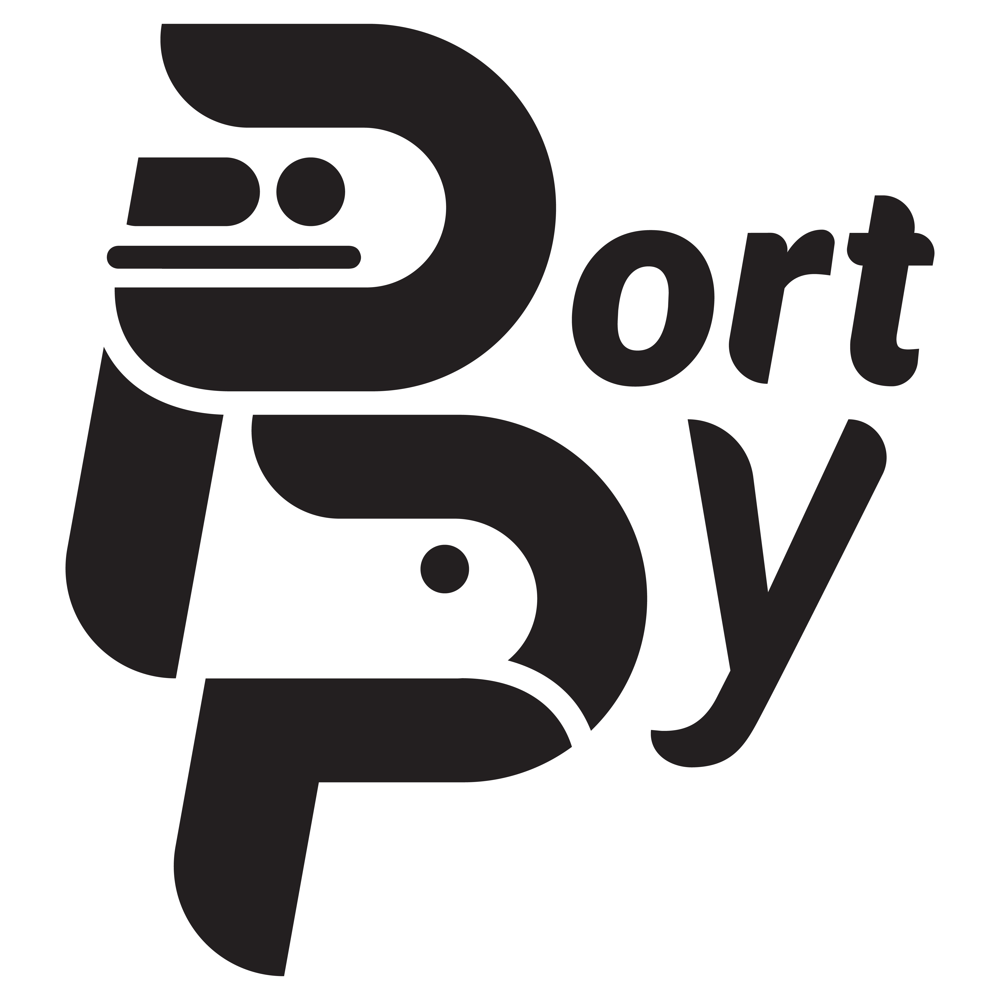
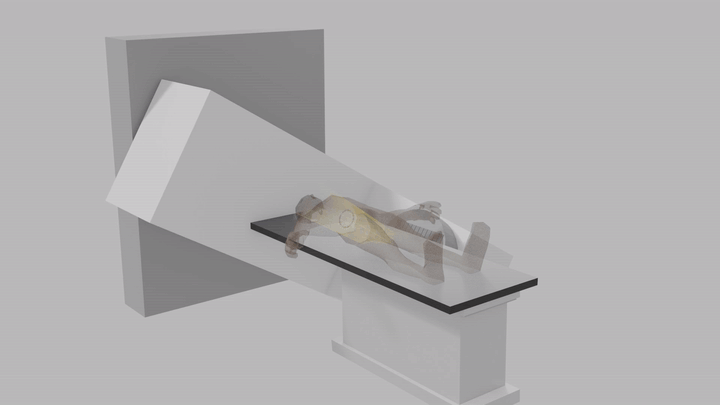
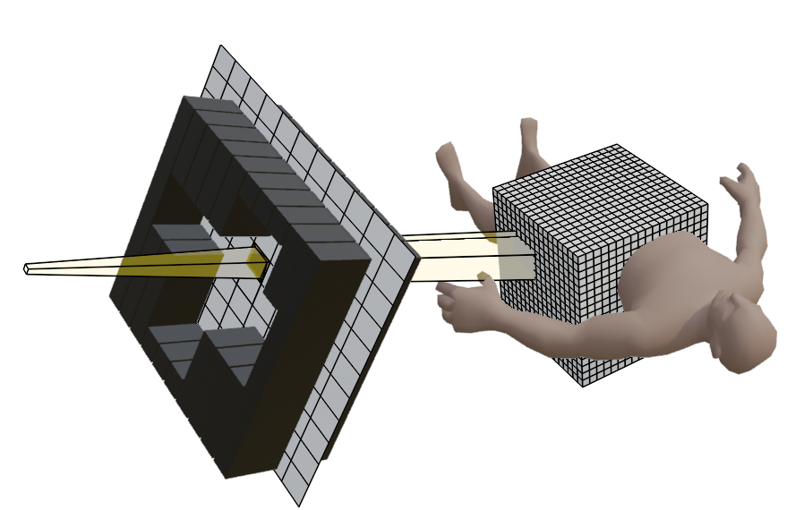
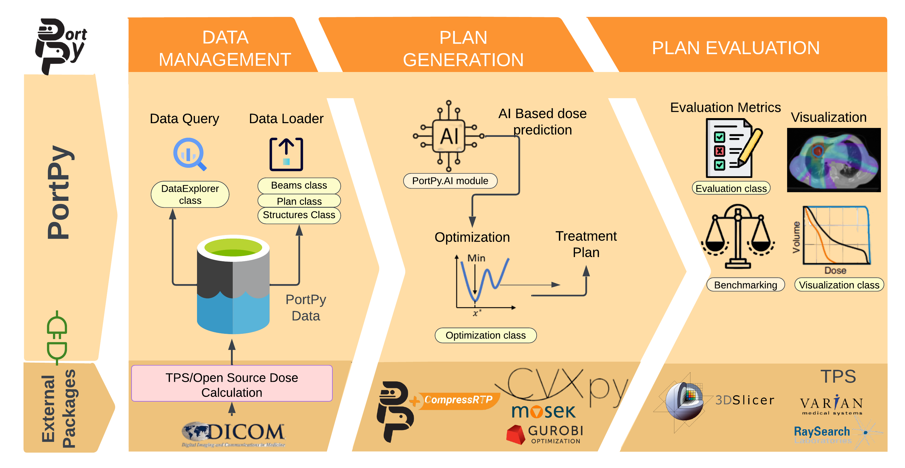
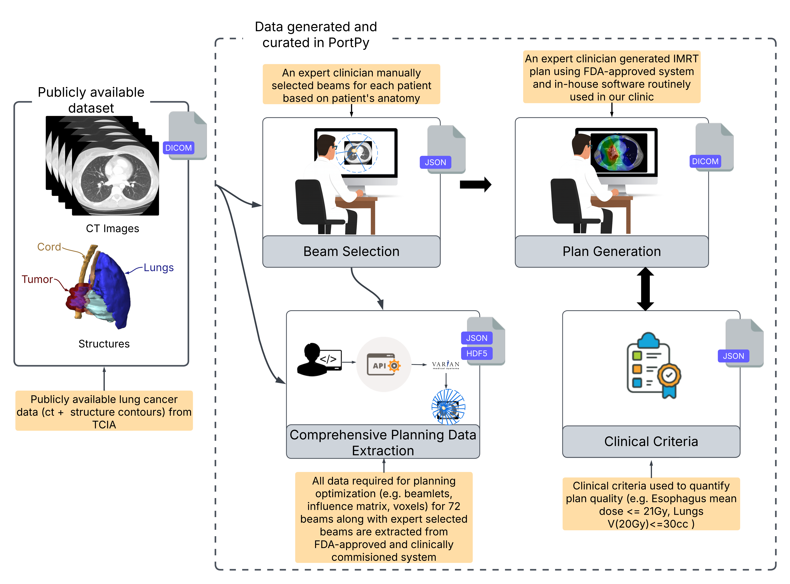

<p align="center">
  
</p>

<h2 align="center">
  <a href="https://portpy-project.github.io/portpy.github.io/">Documentation Website </a> | 
  <a href="#What">What is PortPy? </a> | 
    <a href="#RadOpt101">Radiotherapy Optimization 101 </a>

</h2>


[](https://pepy.tech/project/portpy?&left_text=totalusers)
[](https://pepy.tech/project/portpy)


**Note**: If you have any questions about PortPy, please create an [Issue](https://github.com/PortPy-Project/PortPy/issues) on Github. If you are unable to do so for any reason, you may contact Gourav Jhanwar (jhanwarg@mskcc.org)

# What is PortPy? <a name="What"></a>



**PortPy**, short for **P**lanning and **O**ptimization for **R**adiation **T**herapy, is an initiative aimed at creating an open-source Python library for cancer radiotherapy treatment planning optimization. Radiotherapy is a key treatment for over half of all cancer patients, either alone or alongside surgery, chemotherapy, and immunotherapy. It works by directing high-energy radiation beams at tumors to kill cancerous cells. Given that each patient has a unique anatomy, it is essential to customize the radiation beams' shape, angle, and intensity. The goal is to maximize damage to the tumor while minimizing exposure to healthy surrounding tissues. This process involves solving complex, large-scale mathematical optimization problems tailored to each individual patient. PortPy aims to accelerate research in this interdisciplinary field by offering tools, benchmark algorithms, and datasets.

**Contents**
- [Radiotherapy Optimization 101](#RadOpt101)
- [Quick start and examples](#QuickStart)
- [Benchmark data, benchmark algorithms, and PortPy toolkit](#benchmark)
- [High-Level Description of PortPy](#high-level)
- [How to contribute?](#HowContribute)
- [Data](#Data)
- [Installation](#Installation)
- [Team](#Team)


# Radiotherapy Optimization 101 <a name="RadOpt101"></a>


  
The key variables in treatment planning optimization are the parameters of the **radiation beams** (e.g., beams' shape, angle, and intensity). However, the quality of a treatment is primarily measured by the **radiation dose** delivered to the patient’s body. We can connect the beam parameters to the radiation dose using a straightforward linear relationship. First, we divide the patient’s body into small three-dimensional units called **voxels** and each radiation beam into small two-dimensional sections called **beamlets**. By calculating how much radiation each beamlet (j) delivers to each voxel (i), and representing this with a value **aij**, we create what is known as the **dose deposition matrix (A)**. This matrix links the intensities of the beamlets (x) to the total radiation dose delivered (d) using the equation: **d=Ax**. A general radiotherapy optimization problem can be formulated as:

Minimize f(Ax,x)
subject to g(Ax,x)<=0, x>=0

where f and g are functions that evaluate the quality of radiation dose (Ax) and the beamlet intensities (x). These optimization problems are typically **large**, **non-convex**, and involve **multiple conflicting criteria** (i.e., tumor irradiation vs healthy tissues’ sparing). They must be solved quickly for each patient, often within minutes, seconds, or even milliseconds, depending on whether the planning is done offline, online, or in real-time.

**Note:** If you are new to the field, we suggest reviewing relevant literature review papers
([Zarepisheh et al. 2021](https://pubsonline.informs.org/doi/abs/10.1287/inte.2021.1095), 
[Breedveld et al. 2019](https://www.sciencedirect.com/science/article/abs/pii/S0377221718307148), 
[Ehrgott et al. 2010](https://link.springer.com/article/10.1007/s10479-009-0659-4)) and watching YouTube videos 
([Edelman competition](https://www.youtube.com/watch?v=895M6j5KjPs&t=1025s), 
[Varian IMRT](https://www.youtube.com/watch?v=eZS6DVGBx0k), 
[Elekta VMAT](https://www.youtube.com/watch?v=AE1SxvnFT3s)). In the near future, 
we plan to launch an educational YouTube channel to assist researchers new to this field. **Meanwhile, you can support this effort by starring this GitHub page, which will help us secure funding for further development.**


# Quick start and examples <a name="QuickStart"></a>
The easiest way to start is through the following PortPy Jupyter Notebook examples. 

| Example File                          	                                                                                                                       | Description                                                                                                                                                           	                                                                          |
|---------------------------------------------------------------------------------------------------------------------------------------------------------------|--------------------------------------------------------------------------------------------------------------------------------------------------------------------------------------------------------------------------------------------------|
| [1_basic_tutorial.ipynb](https://github.com/PortPy-Project/PortPy/blob/master/examples/1_basic_tutorial.ipynb)                	                               | Demonstrates the main functionalities of PortPy (e.g., Access data, create an IMRT plan, visualize)                                                                   	                                                                          |
| [eclipse_photon_dose_calculation.ipynb](https://github.com/PortPy-Project/PortPy/blob/master/examples/eclipse_photon_dose_calculation.ipynb)                	 | Demonstrates the capability of running dose calculation for patients outside PortPy dataset using Varian's photon dose calculation module and perform optimization in PortPy                                                                   	 |
| [vmat_scp_tutorial.ipynb](https://github.com/PortPy-Project/PortPy/blob/master/examples/vmat_scp_tutorial.ipynb)               	                              | Creates a VMAT plan using sequential convex programming                                                                                                               	                                                                          |
| [vmat_scp_dose_prediction.ipynb](https://github.com/PortPy-Project/PortPy/blob/master/examples/vmat_scp_dose_prediction.ipynb)                                | Predicts 3D dose distribution using deep learning and converts it into a deliverable VMAT plan                                                                        	                                                                          |
| [3d_slicer_integration.ipynb](https://github.com/PortPy-Project/PortPy/blob/master/examples/3d_slicer_integration.ipynb)           	                          | Creates an IMRT plan and visualizes it in 3D-Slicer                                                                                                                   	                                                                          |
| [imrt_tps_import.ipynb](https://github.com/PortPy-Project/PortPy/blob/master/examples/imrt_tps_import.ipynb)                	                                 | 1. Outputs IMRT plan in DICOM RT format and imports it into TPS. <br>2. Outputs IMRT plan optimal fluence in an Eclipse-compatable format and imports it into Eclipse 	                                                                          |
| [vmat_tps_import.ipynb](https://github.com/PortPy-Project/PortPy/blob/master/examples/vmat_tps_import.ipynb)                 	                                | Outputs VMAT plan in DICOM RT format and imports it into TPS                                                                                                          	                                                                          |
| [imrt_dose_prediction.ipynb](https://github.com/PortPy-Project/PortPy/blob/master/examples/imrt_dose_prediction.ipynb)            	                           | Predicts 3D dose distribution using deep learning and converts it into a deliverable IMRT plan                                                                        	                                                                          |
| [beamlet_dose_prediction.ipynb](https://github.com/PortPy-Project/PortPy/blob/master/examples/beamlet_dose_prediction.ipynb)            	                     | Predicts the dose of individual beamlets using deep learning to build the dose-influence matrix, and uses it to create a plan                                         	                                                                          |
| [vmat_global_optimal.ipynb](https://github.com/PortPy-Project/PortPy/blob/master/examples/vmat_global_optimal.ipynb)           	                              | Finds a globally optimal VMAT plan                                                                                                                                    	                                                                          |
| [beam_orientation_global_optimal.ipynb](https://github.com/PortPy-Project/PortPy/blob/master/examples/beam_orientation_global_optimal.ipynb) 	                | Finds globally optimal beam angles for IMRT                                                                                                                           	                                                                          |
| [dvh_constraint_global_optimal.ipynb](https://github.com/PortPy-Project/PortPy/blob/master/examples/dvh_constraint_global_optimal.ipynb)  	                   | Finds a globally optimal plan meeting Dose Volume Histogram (DVH) constraints                                                                                         	                                                                          |
| [imrt_scp_tutorial.ipynb](https://github.com/PortPy-Project/PortPy/blob/master/examples/imrt_scp_tutorial.ipynb)  	                                           | Creates a step-and-shoot IMRT plan with multiple apertures per beam using column generation and sequential convex programming                                         	                                                                          |
| [imrt_global_optimal.ipynb](https://github.com/PortPy-Project/PortPy/blob/master/examples/imrt_global_optimal.ipynb)  	                                       | Compares deliverable IMRT plans from leaf sequencing, column generation, SCP, and a globally optimal mixed-integer program                                            	                                                                          |


# Benchmark data, benchmark algorithms, and PortPy toolkit <a name="benchmark"></a>

PortPy provides three components that researchers can build on:

1. **PortPy Toolkit**. Develop, test, and validate new treatment planning optimization algorithms.
2. **Benchmark Datasets**. 200 lung and 129 prostate patients containing everything needed for plan optimization (beamlets, voxels, dose influence matrix), extracted from the FDA-approved Eclipse treatment planning system through its API. See [Data](#Data).
3. **Benchmark Algorithms**. Many planning problems (e.g., VMAT) are non-convex, so algorithms can get trapped in local optima. Formulating them as Mixed Integer Programs (MIP) yields globally optimal solutions that serve as "ground truth" for evaluating faster methods, at the cost of days of computation per patient. See [vmat_global_optimal.ipynb](https://github.com/PortPy-Project/PortPy/blob/master/examples/vmat_global_optimal.ipynb), [imrt_global_optimal.ipynb](https://github.com/PortPy-Project/PortPy/blob/master/examples/imrt_global_optimal.ipynb), [beam_orientation_global_optimal.ipynb](https://github.com/PortPy-Project/PortPy/blob/master/examples/beam_orientation_global_optimal.ipynb), and [dvh_constraint_global_optimal.ipynb](https://github.com/PortPy-Project/PortPy/blob/master/examples/dvh_constraint_global_optimal.ipynb).


# High-Level Description of PortPy <a name="high-level"></a>

<p align="center">

<p>

PortPy is organized into three modules: **Data Management**, **Plan Generation**, and **Plan
Evaluation**. The [example notebooks](#QuickStart) show them in use.

1. **Data Management**
     * Access to the curated benchmark dataset — CT images and contours, all necessary data for optimization extracted from Eclipse using its API (version 16.1) , expert-selected beams, and a benchmark IMRT plan per patient generated with our in-house automated planning system ECHO ([video](https://youtu.be/895M6j5KjPs), [paper](https://aapm.onlinelibrary.wiley.com/doi/epdf/10.1002/mp.13572)). See [Data](#Data) and [1_basic_tutorial.ipynb](https://github.com/PortPy-Project/PortPy/blob/master/examples/1_basic_tutorial.ipynb)
     * You can also bring your own patients (Eclipse users only), using Varian's photon dose calculation module (see [eclipse_photon_dose_calculation.ipynb](https://github.com/PortPy-Project/PortPy/blob/master/examples/eclipse_photon_dose_calculation.ipynb))
      ```python
      # Use PortPy DataExplorer class to explore PortPy data
      data = pp.DataExplorer(data_dir='../data')
      # Load ct, structure set, beams for the above patient using CT, Structures, and Beams classes
      ct = pp.CT(data)
      structs = pp.Structures(data)
      beams = pp.Beams(data)
      # By default, PortPy uses the beams selected by an expert planner, which are included as part of the dataset.
      ```

2. **Plan Generation**
     * Plans can be generated with classical optimization or AI-based methods
     * Optimization problems are formulated with [CVXPy](https://www.cvxpy.org/), giving access to free ([SCIP](https://www.scipopt.org/), [SCIPY](https://docs.scipy.org/doc/scipy/reference/optimize.html)) and commercial ([MOSEK](https://www.mosek.com/), [CPLEX](https://www.ibm.com/products/ilog-cplex-optimization-studio/cplex-optimizer), [GUROBI](https://www.gurobi.com/)) solvers, all free for academic use (see [1_basic_tutorial.ipynb](https://github.com/PortPy-Project/PortPy/blob/master/examples/1_basic_tutorial.ipynb))
     * The PortPy.AI module covers data pre-processing, model training and testing, and patient-specific 3D dose prediction (see [imrt_dose_prediction.ipynb](https://github.com/PortPy-Project/PortPy/blob/master/examples/imrt_dose_prediction.ipynb))

      ```python
      # Load optimization parameters and clinical criteria
      clinical_criteria = pp.ClinicalCriteria(data, protocol_name='Lung_2Gy_30Fx')
      opt_params = data.load_config_opt_params(protocol_name='Lung_2Gy_30Fx')
      
      # Load influence matrix
      inf_matrix = pp.InfluenceMatrix(ct=ct, structs=structs, beams=beams)
      # create a plan object
      my_plan = pp.Plan(ct = ct, structs = structs, beams = beams, inf_matrix = inf_matrix, clinical_criteria=clinical_criteria)
      
      # create cvxpy problem using the clinical criteria and optimization parameters and solve it
      opt = pp.Optimization(my_plan, opt_params=opt_params, clinical_criteria=clinical_criteria)
      opt.create_cvxpy_problem()
      sol = opt.solve(solver='MOSEK', verbose=False)
      ```

3. **Plan Visualization and Evaluation**
     * Basic built-in visualization tools (e.g., DVH, dose distribution) are integrated into PortPy 
     * Enhanced visualizations are available through the integration with the popular open-source [3DSlicer](https://www.slicer.org/) package (see [3d_slicer_integration.ipynb](https://github.com/PortPy-Project/PortPy/blob/master/examples/3d_slicer_integration.ipynb) notebook)
     * Plans can be quantitatively evaluated using well-established clinical protocols (e.g., Lung 2Gyx30, see  [basic_tutorial.ipynb](https://github.com/PortPy-Project/PortPy/blob/master/examples/1_basic_tutorial.ipynb))
     * Plans can be imported into any TPS for final clinical evaluations  (see [imrt_tps_import.ipynb](https://github.com/PortPy-Project/PortPy/blob/master/examples/imrt_tps_import.ipynb))  

      ```python
      # plot fluence in 3d for the 1st beam
      pp.Visualization.plot_fluence_3d(sol=sol, beam_id=my_plan.beams.get_all_beam_ids()[0])
      # plot dvh for the structures
      pp.Visualization.plot_dvh(my_plan, sol=sol, struct_names=['PTV', 'CORD'], title=data.patient_id)
      # plot 2d axial slice for the given solution and display the structures contours on the slice
      pp.Visualization.plot_2d_slice(my_plan=my_plan, sol=sol, slice_num=60, struct_names=['PTV'])
      # visualize plan metrics and compare them against the clinical criteria
      pp.Evaluation.display_clinical_criteria(my_plan, sol=sol, clinical_criteria=clinical_criteria)
      ```

# How to contribute? <a name="HowContribute"></a>

PortPy-Project includes the core **PortPy** repository (this repo) and separate **extension repositories** built on top of PortPy. To keep PortPy lightweight and easy to use, we aim to include only core functionality, benchmark data, and reference algorithms here, while hosting project-specific work in separate repos (e.g., [CompressRTP](https://github.com/PortPy-Project/LowDimRT) and [ECHO VMAT](https://github.com/PortPy-Project/ECHO-VMAT)).

If you’d like to contribute to existing modules or start a new one, please contact us first so we can align on goals and priorities. If you build your own package using PortPy, you can host it under the [PortPy-Project organization](https://github.com/PortPy-Project) or on your own GitHub—if you choose the latter, let us know so we can fork it and feature it under PortPy-Project. You can also customize our [pre-designed logo](https://www.canva.com/design/DAFxivHC0Js/YqZREdr26pmEsIgCeuU-iA/view?utm_content=DAFxivHC0Js&utm_campaign=designshare&utm_medium=link&utm_source=publishsharelink&mode=preview).


# Data <a name="Data"></a>



PortPy equips researchers with a robust benchmark patient dataset, sourced from the FDA-approved Eclipse commercial treatment planning system through its API. This dataset embodies all necessary elements for optimizing various machine configurations such as beam angles, aperture shapes, and leaf movements. It includes

1. **Dose Influence Matrix (AKA dose deposition matrix, dij matrix):** The dose contribution of each beamlet to each voxel,
2. **Beamlets/Voxels Details:** Detailed information about the position and size of beamlets/voxels,
3. **Expert-Selected Benchmark Beams:** An expert clinical physicist has carefully selected benchmark beams, providing reference beams for comparison and benchmarking,
4. **Benchmark IMRT Plan:** A benchmark IMRT plan generated using our in-house automated treatment planning system called ECHO ([YouTube Video](https://youtu.be/895M6j5KjPs), [Paper](https://aapm.onlinelibrary.wiley.com/doi/epdf/10.1002/mp.13572)). This plan serves as a benchmark for evaluating new treatment planning algorithms.
5. **Benchmark Clinical Criteria:** A set of clinically relevant mean/max/DVH criteria for plan evaluation. 
Currently, this set includes lung (2Gy×30) and prostate (26Fx, 5Gy×5Fx) protocols, and will be expanded in the future to more protocols as well as TCP/NTCP evaluation functions.  

The dataset is hosted on Hugging Face: [PortPy_Dataset](https://huggingface.co/datasets/PortPy-Project/PortPy_Dataset).

Pretrained models and reference optimization solutions are published separately in [PortPy-Project/artifacts](https://github.com/PortPy-Project/artifacts) and can be fetched with `pp.download_artifact(...)`.
## Downloading the PortPy Dataset

PortPy datasets are large (GBs per patient) and are **not bundled** with the Python package. Download them either from the command line (recommended) or from Python.

### Option 1: CLI

```bash
pip install "portpy[data]"
download_portpy_data --patients Lung_Patient_3 Lung_Patient_4 --beam-mode planner --out ./PortPy_Dataset
```
- `--patients`: List of patient IDs to download. You can find the list of available patient IDs on the [Hugging Face Dataset Page](https://huggingface.co/datasets/PortPy-Project/PortPy_Dataset).
- `--beam-mode`: Options are "all" or "planner" or beam ids list e.g., [0,10,20]. Default is "planner"
- `--out`: Output directory to save the downloaded data.

### Option 2: Python (pp.download_portpy_data)

Use the same downloader from Python (useful for scripts, notebooks and pipelines):
```python
import portpy.photon as pp

pp.download_portpy_data(
    ["Lung_Patient_3", "Lung_Patient_4"],
    out="./", # output directory
    beam_mode="planner", # options: "all" or "planner" or beam ids list e.g., [0,10,20]. Default is "planner"
)
```

Point `pp.DataExplorer(data_dir=...)` at the download directory (e.g., `./data/`), which holds one folder per patient (e.g., `./data/Lung_Patient_3`). Data is stored in JSON and HDF5; [HDFView](https://www.hdfgroup.org/downloads/hdfview/) can inspect the HDF5 files. You can also browse and download patients manually through our interactive [Hugging Face Space](https://huggingface.co/spaces/PortPy-Project/portpy_dataset_visualization), though this is slower and not recommended.  

**Note:** The patient anatomy comes from two public, de-identified collections of [TCIA](https://www.cancerimagingarchive.net/): [NSCLC-Radiomics](https://www.cancerimagingarchive.net/collection/nsclc-radiomics/) (lung, CC BY-NC 3.0, Aerts et al.) and [Prostate-Anatomical-Edge-Cases](https://doi.org/10.7937/QSTF-ST65) (prostate, CC BY 4.0, Kanwar et al.); please cite them alongside PortPy. Users can fetch the **TCIA collection ID** and the **TCIA subject ID** for each PortPy patient using the *get_tcia_metadata()* method in PortPy and subsequently download the data from TCIA (see [imrt_tps_import](https://github.com/PortPy-Project/PortPy/blob/master/examples/imrt_tps_import.ipynb))


# Installation <a name="Installation"></a>

**Using pip:**
```bash
pip install portpy                      # core
pip install "portpy[mosek,pydicom]"     # MOSEK solver and DICOM support
pip install "portpy[ai]"                # AI/deep-learning modules
pip install "portpy[data]"              # dataset downloader
pip install "portpy[all]"               # everything above
```

**From source:**
```bash
git clone https://github.com/PortPy-Project/PortPy.git
cd PortPy
pip install -r requirements.txt
```


# Team <a name="Team"></a>
PortPy is a community project initiated at [Memorial Sloan Kettering Cancer Center](https://www.mskcc.org/) (MSK). It is currently developed and maintained by [Masoud Zarepisheh](https://masoudzp.github.io/) (Principal Investigator, zarepism@mskcc.org) and [Gourav Jhanwar](https://github.com/gourav3017) (Lead Developer, jhanwarg@mskcc.org). Other team members include: [Mojtaba Tefagh](https://www.ed.ac.uk/profile/mojtaba-tefagh) (Optimization/AI/ML expert from University of Edinburgh), [Linda Hong](https://www.mskcc.org/profile/linda-hong) (Medical Physicist from MSK), [Vicki Taasti](https://scholar.google.com/citations?user=PEPyvewAAAAJ&hl=en) (Proton Physicist from Aarhus University), and [Saad Nadeem](https://nadeemlab.org/) (AI/Imaging expert from MSK). 

# License <a name="License"></a>
PortPy code is distributed under **Apache 2.0 with Commons Clause** license, and is available for non-commercial academic purposes.

# Reference <a name="Reference"></a>
If you find our work useful in your research or if you use parts of this code, please cite our NeurIPS 2026 paper (to appear):
```
@inproceedings{jhanwar2026portpyai,
  title={PortPy.AI: A Benchmark for AI and Optimization in Cancer Radiotherapy Planning},
  author={Jhanwar, Gourav and Tefagh, Mojtaba and Huang, Qijie and Golkarieh, Alireza and Hong, Linda and Pham, Hai and Taasti, Vicki Trier and Tuomaala, Seppo and Magliari, Anthony and Folkerts, Michael and Zhou, Ying and Yang, Jie and Nadeem, Saad and Zarepisheh, Masoud},
  booktitle={Advances in Neural Information Processing Systems (NeurIPS), Evaluations and Datasets Track},
  year={2026}
}
```
