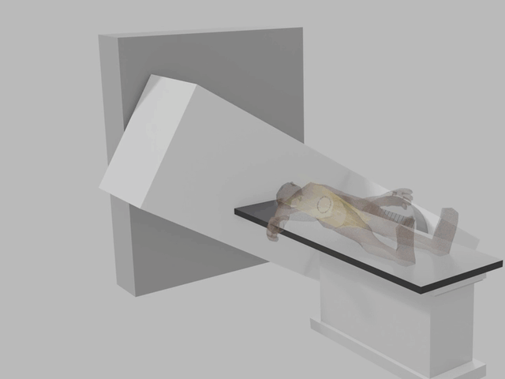
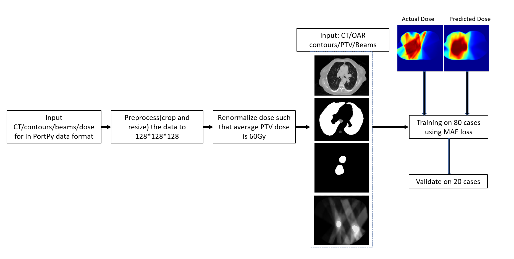

<p align="center">
  
</p>

<h3 align="center">Planning and Optimization for Radiation Therapy in Python</h3>

<p align="center">
  <a href="https://pypi.org/project/portpy/"></a>
  <a href="https://pypi.org/project/portpy/"></a>
  <a href="./LICENSE.txt"></a>
  <a href="https://github.com/PortPy-Project/PortPy/actions/workflows/ci.yml"></a>
  <a href="https://portpy-project.github.io/portpy.github.io/"></a>
  <a href="https://huggingface.co/datasets/PortPy-Project/PortPy_Dataset"></a>
  <a href="#citing-portpy"></a>
  <a href="https://pepy.tech/project/portpy"></a>
</p>

<p align="center">
  <a href="https://portpy-project.github.io/portpy.github.io/">Documentation</a> ·
  <a href="#quickstart">Quickstart</a> ·
  <a href="#examples">Examples</a> ·
  <a href="#portpyai-benchmark">PortPy.AI benchmark</a> ·
  <a href="#data">Data</a> ·
  <a href="#citing-portpy">Paper</a>
</p>



**PortPy** is an open-source Python platform for **cancer radiotherapy treatment-planning research**.
Radiotherapy treats roughly half of all cancer patients by aiming high-energy beams at a tumor
from many directions. Choosing the shape, angle and intensity of those beams for each patient is a
large-scale, multi-criteria, often non-convex optimization problem.

PortPy gives researchers in **medical physics, mathematical optimization and AI/ML** a common,
clinically grounded playground: real patient data with everything needed to optimize a plan, reference
algorithms that are used clinically, AI baselines, and tools to evaluate a plan the way a clinic would.
PortPy was initiated at [Memorial Sloan Kettering Cancer Center](https://www.mskcc.org/) and is free
for non-commercial academic use.

<br clear="right">

## Why PortPy?

- **Clinically realistic data.** Beamlet-to-voxel dose matrices, beams, voxels, expert-selected
  beams and reference plans extracted from the FDA-approved Varian Eclipse treatment planning
  system (TPS) with its clinically commissioned dose engine, for **200 lung and 129 prostate patients**.
- **Deliverable plans.** PortPy models the actual multi-leaf collimator (MLC) and exports IMRT and
  VMAT plans as DICOM-RT, so a plan can be imported into a clinical TPS and recalculated.
- **Clinically deployed algorithms.** The VMAT and step-and-shoot IMRT optimizers (column generation +
  sequential convex programming) are the engine of MSK's in-house automated planning system,
  ECHO, which has planned more than 10,000 patients.
- **Global-optimality references.** Mixed-integer formulations for VMAT, IMRT, beam-orientation and
  DVH-constrained planning give slow but exact answers to benchmark fast heuristics against.
- **An end-to-end AI benchmark.** PortPy.AI defines three tasks (beamlet-dose prediction, total-dose
  prediction, plan optimization) with frozen splits, baselines, and an evaluation protocol that scores
  the *final deliverable plan*, not just the prediction.
- **Open and interoperable.** Problems are built in [CVXPY](https://www.cvxpy.org/) (swap solvers in
  one line), data lives on Hugging Face, plans visualize in [3D Slicer](https://www.slicer.org/), and
  Eclipse users can bring their own patients.

## Quickstart

```bash
pip install "portpy[data]"
```

```python
import portpy.photon as pp

# 1. Data: pick a patient; the first call downloads it from Hugging Face (~2 GB with expert beams)
data = pp.DataExplorer(hf_repo_id="PortPy-Project/PortPy_Dataset", local_download_dir="./portpy_data")
data.patient_id = "Lung_Patient_3"
data.filter_and_download_hf_dataset()
ct, structs, beams = pp.CT(data), pp.Structures(data), pp.Beams(data)

# 2. Plan: load a clinical protocol and solve an IMRT fluence-map optimization
protocol = "Lung_2Gy_30Fx"
criteria = pp.ClinicalCriteria(data, protocol_name=protocol)
opt_params = data.load_config_opt_params(protocol_name=protocol)
structs.create_opt_structures(opt_params=opt_params, clinical_criteria=criteria)
inf_matrix = pp.InfluenceMatrix(ct=ct, structs=structs, beams=beams)
plan = pp.Plan(ct=ct, structs=structs, beams=beams, inf_matrix=inf_matrix, clinical_criteria=criteria)
opt = pp.Optimization(plan, opt_params=opt_params, clinical_criteria=criteria)
opt.create_cvxpy_problem()
sol = opt.solve(solver="SCS", verbose=False)   # free solver, a few minutes; MOSEK/GUROBI (free academic licenses) are much faster

# 3. Evaluate: DVH, dose on a CT slice, and a clinical scorecard
pp.Visualization.plot_dvh(plan, sol=sol, struct_names=["PTV", "CORD", "ESOPHAGUS", "LUNGS_NOT_GTV"])
pp.Visualization.plot_2d_slice(my_plan=plan, sol=sol, slice_num=60, struct_names=["PTV", "CORD"])
pp.Evaluation.display_clinical_criteria(plan, sol=sol, clinical_criteria=criteria)
```

The full walk-through, including saving plans and viewing them in 3D Slicer, is in
[`1_basic_tutorial.ipynb`](./examples/1_basic_tutorial.ipynb). Installation options are
[below](#installation).

## What's inside

<p align="center">
  
</p>

| Module | What it does | Key classes |
|---|---|---|
| **Data management** | Browse, filter and download the benchmark dataset from Hugging Face or load it locally; build the dose-influence matrix; down-sample or sparsify it | `DataExplorer`, `CT`, `Structures`, `Beams`, `InfluenceMatrix` |
| **Plan generation** | Formulate and solve planning problems with CVXPY (IMRT fluence maps, VMAT and step-and-shoot IMRT with deliverability constraints, MIP references); predict dose with deep learning | `Optimization`, `VmatScpOptimization`, `VmatOptimizationColGen`, `ImrtScpOptimization`, `portpy.ai` |
| **Plan evaluation** | DVHs, dose maps, fluence maps, clinical-criteria scorecards, overall plan score, conformity/homogeneity indices; 3D Slicer views; DICOM-RT and Eclipse fluence export | `Evaluation`, `Visualization`, `write_rt_plan_imrt`, `write_rt_plan_vmat` |

## Examples

Every example is a Jupyter notebook under [`examples/`](./examples) (plain `.py` versions in
[`examples/python_files/`](./examples/python_files)). The *Needs* column tells you what beyond
`pip install portpy` is required. All notebooks use MOSEK by default; any CVXPY solver works
for the convex problems.

**Start here**

| Notebook | What you learn | Needs |
|---|---|---|
| [1_basic_tutorial](./examples/1_basic_tutorial.ipynb) | Load a patient, create an IMRT plan, visualize and evaluate it, save and reload | – |
| [structure_operations](./examples/structure_operations.ipynb) | Union, intersection, subtraction, expansion and shrinking of structures | – |
| [inf_matrix_down_sampling](./examples/inf_matrix_down_sampling.ipynb) | Down-sample beamlets and voxels for faster experiments, and what it costs | – |
| [inf_matrix_sparsification](./examples/inf_matrix_sparsification.ipynb) | Sparse vs. full influence matrix; truncation thresholds | – |

**IMRT and VMAT planning**

| Notebook | What you learn | Needs |
|---|---|---|
| [vmat_scp_tutorial](./examples/vmat_scp_tutorial.ipynb) | VMAT planning with column generation + sequential convex programming; export the DICOM-RT plan | – |
| [imrt_scp_tutorial](./examples/imrt_scp_tutorial.ipynb) | Step-and-shoot IMRT with several apertures per beam via column generation + SCP | – |
| [dose_mimicking](./examples/dose_mimicking.ipynb) | Optimize a plan to reproduce a given reference dose (dose mimicking) | Eclipse |

**How far from the global optimum?** (mixed-integer programming references)

| Notebook | What you learn | Needs |
|---|---|---|
| [vmat_global_optimal](./examples/vmat_global_optimal.ipynb) | Globally optimal VMAT plan on a down-sampled problem vs. column generation and SCP | MIP solver |
| [imrt_global_optimal](./examples/imrt_global_optimal.ipynb) | Compares fluence-map + leaf sequencing, column generation, SCP and a deliverability-constrained MIP | Gurobi |
| [beam_orientation_global_optimal](./examples/beam_orientation_global_optimal.ipynb) | Globally optimal beam angles for IMRT | MIP solver |
| [dvh_constraint_global_optimal](./examples/dvh_constraint_global_optimal.ipynb) | Globally optimal plan that meets dose-volume-histogram constraints | Gurobi |

**AI-based dose prediction** (`portpy.ai`)

| Notebook | What you learn | Needs |
|---|---|---|
| [beamlet_dose_prediction](./examples/beamlet_dose_prediction.ipynb) | Task 1: predict the dose of individual beamlets with a 3D U-Net, assemble a predicted influence matrix, and plan with it | GPU, `portpy[ai]` |
| [imrt_dose_prediction](./examples/imrt_dose_prediction.ipynb) | Task 2: predict a patient's 3D dose distribution and turn it into a deliverable IMRT plan | GPU, `portpy[ai]` |
| [vmat_scp_dose_prediction](./examples/vmat_scp_dose_prediction.ipynb) | Task 2 for VMAT: predicted dose as the reference for SCP-based VMAT planning | GPU, `portpy[ai]` |

**Clinical integration**

| Notebook | What you learn | Needs |
|---|---|---|
| [imrt_tps_import](./examples/imrt_tps_import.ipynb) | Leaf-sequence an IMRT plan to DICOM-RT and import it into a TPS; export optimal fluence to Eclipse | TPS / Eclipse |
| [vmat_tps_import](./examples/vmat_tps_import.ipynb) | Export a VMAT plan as DICOM-RT and import it into a TPS | TPS |
| [eclipse_photon_dose_calculation](./examples/eclipse_photon_dose_calculation.ipynb) | Bring your own patients: extract beamlets, voxels and the influence matrix from Eclipse with Varian's [MAAS-DoseInfluenceMatrix](https://github.com/Varian-MedicalAffairsAppliedSolutions/MAAS-DoseInfluenceMatrix) tool, then plan in PortPy | Eclipse |
| [3d_slicer_integration](./examples/3d_slicer_integration.ipynb) | View CT, structures and dose in 3D Slicer from a Jupyter notebook | 3D Slicer |

## PortPy.AI benchmark

<p align="center">
  
</p>

**PortPy.AI** ([NeurIPS 2026, Evaluations and Datasets Track](#citing-portpy)) turns PortPy into an
end-to-end benchmark for AI and optimization in radiotherapy planning. Three tasks follow the
planning pipeline, and each is evaluated at two levels: its own accuracy **and** the clinical quality
of the deliverable plan it leads to.

| Task | Input → Output | Why it matters | Baselines in PortPy |
|---|---|---|---|
| **1. Beamlet-dose prediction** | CT + beamlet geometry → 3D dose of one beamlet | Replaces the expensive physics computation of the dose-influence matrix *A* | 3D U-Net, 3D ViT, 3D Swin UNETR |
| **2. Total-dose prediction** | CT + structure masks + beam encoding → 3D dose distribution | Gives the optimizer a patient-specific target and removes manual weight tuning | MedNeXt (+ attention and dual-decoder variants), U-Net |
| **3. Plan optimization** | *A*, reference dose, clinical criteria → deliverable beam shapes and intensities | The large-scale, non-convex combinatorial core of planning | Column generation + SCP (clinical), column generation only, MIP (global reference) |

- **Dataset:** 200 lung and 129 prostate patients; 72 candidate beams per patient at 5° spacing;
  3 mm voxels; 2.5 mm beamlets; beamlet dose from Eclipse's AAA engine; expert reference plans;
  harmonized structure names; clinical criteria as editable JSON. See [Data](#data).
- **Splits:** frozen, patient-level 80/10/10 splits ship with the package
  (`portpy/config_files/data_splits/data_splits_default.json`; load with
  `DataExplorer.load_config_data_splits`). Task 1 pools both sites; Task 2 is site-specific.
- **Metrics:** mean absolute error for the prediction tasks; for every task the **clinical scorecard**
  (`Evaluation.display_clinical_criteria`) and the **overall plan score**
  (`Evaluation.get_plan_score`, a points-based DVH scorecard adapted from planning competitions);
  runtime for Task 3.

Baseline results from the paper (mean ± SD over the test split; Task 3 on one representative VMAT patient):

| Task | Baseline | Upstream metric | Plan score (reference) | Plan score (method) |
|---|---|---|---|---|
| 1 | 3D U-Net | MAE 1.4 × 10⁻⁴ | 53.95 ± 14.64 (physics-based *A*) | 52.30 ± 15.51 (predicted *A*) |
| 2 | MedNeXt, lung | MAE 1.105 Gy | 50.29 ± 9.74 (expert plan) | 45.69 ± 11.79 |
| 2 | MedNeXt, prostate | MAE 0.442 Gy | 52.35 ± 12.17 (expert plan) | 48.11 ± 16.19 |
| 3 | MIP (global reference) | 10,080 min | – | 71.52 |
| 3 | Column generation + SCP | 1.45 min | – | 71.48 |
| 3 | Column generation only | 0.14 min | – | 65.27 |

A central finding: models that are indistinguishable on MAE can differ by 15 % in plan score, and the
ranking can flip. Report the downstream plan quality, not only the prediction error.
Training, inference and evaluation code for all baselines is in `portpy.ai` and the
[AI notebooks](#examples).

<details>
<summary><b>Radiotherapy optimization in two minutes</b> (click to expand)</summary>


The decision variables in treatment planning are the parameters of the **radiation beams** (angles,
shapes, intensities), but plan quality is judged by the **dose** delivered to the patient. The two are
linked linearly. The patient is discretized into small 3D **voxels** and each beam into small 2D
**beamlets**. A physics-based dose engine computes the dose *a<sub>ij</sub>* that beamlet *j* deposits in
voxel *i*; collecting these values gives the **dose-influence matrix** *A* (also called the dose-deposition
or *d<sub>ij</sub>* matrix). With beamlet intensities *x*, the dose is simply **d = A x**.

A planning problem then reads

```
minimize   f(Ax, x)
subject to g(Ax, x) ≤ 0,   x ≥ 0
```

where *f* and *g* score the dose (tumor coverage, organ sparing) and the beamlets (smoothness, machine
deliverability). Typical instances have 10,000–100,000 beamlets and 100,000–1,000,000 voxels, several
competing objectives, and, once MLC deliverability is modelled, a non-convex combinatorial structure.
They must be solved per patient within minutes to hours.

New to the field? These reviews are a good start:
[Zarepisheh et al. 2022](https://pubsonline.informs.org/doi/abs/10.1287/inte.2021.1095),
[Breedveld et al. 2019](https://www.sciencedirect.com/science/article/abs/pii/S0377221718307148),
[Ehrgott et al. 2010](https://link.springer.com/article/10.1007/s10479-009-0659-4);
and these videos: [ECHO at the Edelman competition](https://www.youtube.com/watch?v=895M6j5KjPs&t=1025s),
[Varian IMRT](https://www.youtube.com/watch?v=eZS6DVGBx0k), [Elekta VMAT](https://www.youtube.com/watch?v=AE1SxvnFT3s).

<br clear="right">
</details>

## Data


The benchmark dataset is hosted on Hugging Face:
[**PortPy-Project/PortPy_Dataset**](https://huggingface.co/datasets/PortPy-Project/PortPy_Dataset)
(license CC BY-NC 4.0). Each patient folder contains:

1. **Dose-influence matrix** – dose contribution of every beamlet to every voxel, for 72 candidate beams
2. **Beamlet and voxel geometry** – positions and sizes, CT and structure masks
3. **Expert-selected beams** – the beam arrangement a clinical physicist chose for the patient
4. **Reference plan** – a deliverable IMRT plan from MSK's automated planning system ECHO
   ([video](https://youtu.be/895M6j5KjPs), [paper](https://aapm.onlinelibrary.wiley.com/doi/epdf/10.1002/mp.13572))
5. **Clinical criteria** – mean/max/DVH criteria for the lung (2 Gy × 30) and prostate (2.7 Gy × 26, 5 Gy × 5) protocols

Metadata is JSON; large arrays are HDF5 (inspect them with [HDFView](https://www.hdfgroup.org/downloads/hdfview/)).
The data is **not bundled** with the Python package. A patient is about **2 GB** with the expert-selected
beams and about **20 GB** with all 72 beams.

<br clear="right">

**Download from the command line**

```bash
pip install "portpy[data]"
download_portpy_data --patients Lung_Patient_3 Lung_Patient_4 --beam-mode planner --out ./portpy_data
```

- `--beam-mode planner` (default) downloads the expert-selected beams; `all` downloads all 72;
  `ids` downloads the beams in `--beam-ids`, e.g. `--beam-mode ids --beam-ids 0,10,20`; `none` skips beams.
- Patients are written to `<out>/data/<patient_id>`, so point PortPy at `./portpy_data/data`.

**Download from Python**

```python
import portpy.photon as pp

pp.download_portpy_data(["Lung_Patient_3", "Lung_Patient_4"], out="./portpy_data", beam_mode="planner")
data = pp.DataExplorer(data_dir="./portpy_data/data")
```

Alternatively, let `DataExplorer` fetch patients on demand (as in the [Quickstart](#quickstart)), filter
patients by site, tumor volume or beam properties with `filter_and_download_hf_dataset`, or browse the
dataset in the [Hugging Face Space](https://huggingface.co/spaces/PortPy-Project/portpy_dataset_visualization).

**Source data and attribution.** CT images and contours come from two public, de-identified TCIA
collections: [NSCLC-Radiomics](https://www.cancerimagingarchive.net/collection/nsclc-radiomics/)
(lung, CC BY-NC 3.0, Aerts et al.) and
[Prostate-Anatomical-Edge-Cases](https://doi.org/10.7937/QSTF-ST65) (prostate, CC BY 4.0, Kanwar et al.).
Please cite them alongside PortPy. `DataExplorer.get_tcia_metadata()` returns the TCIA collection and
subject id of each PortPy patient.

## Installation

Python 3.11 or newer.

```bash
pip install portpy                      # core: data access, optimization (Clarabel and SCS solvers), evaluation, visualization
pip install "portpy[data]"              # + Hugging Face downloader
pip install "portpy[mosek,pydicom]"     # + MOSEK solver and DICOM-RT export
pip install "portpy[ai]"                # + PyTorch-based dose-prediction module
pip install "portpy[all]"               # everything above
```

From source:

```bash
git clone https://github.com/PortPy-Project/PortPy.git
cd PortPy
pip install -e ".[all]"
```

**Solvers.** Problems are formulated with CVXPY, so any [CVXPY-supported solver](https://www.cvxpy.org/tutorial/solvers/index.html)
can be used by changing the `solver=` argument. The free solvers SCS and Clarabel are installed with
PortPy and are enough to get started: on the Quickstart problem (about 430,000 voxels × 2,500 beamlets)
SCS takes a few minutes and Clarabel about 20 minutes on a laptop. For routine work, for large problems
and for the mixed-integer notebooks we recommend [MOSEK](https://www.mosek.com/products/academic-licenses/)
or [Gurobi](https://www.gurobi.com/academia/academic-program-and-licenses/), both free for academic use
and much faster.

## Ecosystem

| Project | What it adds |
|---|---|
| [ECHO-VMAT](https://github.com/PortPy-Project/ECHO-VMAT) | Hierarchical (prioritized) automated VMAT planning on top of PortPy |
| [CompressRTP](https://github.com/PortPy-Project/CompressRTP) | Sparse-plus-low-rank and wavelet compression for much faster optimization |
| [Varian MAAS-DoseInfluenceMatrix](https://github.com/Varian-MedicalAffairsAppliedSolutions/MAAS-DoseInfluenceMatrix) | Eclipse scripting tool that exports your own patients in PortPy format |
| [3D Slicer](https://www.slicer.org/) | Advanced visualization of PortPy plans ([notebook](./examples/3d_slicer_integration.ipynb)) |

Building something on PortPy? We would love to feature it. See [CONTRIBUTING.md](./CONTRIBUTING.md).

## Publications

Selected publications by the PortPy team:

- G. Jhanwar *et al.* **PortPy.AI: A Benchmark for AI and Optimization in Cancer Radiotherapy Planning.** NeurIPS 2026, Evaluations and Datasets Track (to appear).
- S. Adeli, M. Tefagh, G. Jhanwar, M. Zarepisheh. **Randomized sparse matrix compression for large-scale constrained optimization in cancer radiotherapy.** NeurIPS 2024.
- M. Tefagh, G. Jhanwar, M. Zarepisheh. **Compressed radiotherapy treatment planning.** *Medical Physics*, 2025.
- P. Dursun, L. Hong, G. Jhanwar *et al.* **Automated VMAT treatment planning using sequential convex programming: algorithm development and clinical implementation.** *Physics in Medicine & Biology*, 2023.
- M. Zarepisheh *et al.* **Automated and clinically optimal treatment planning for cancer radiotherapy.** *INFORMS Journal on Applied Analytics*, 2022.
- G. Jhanwar, N. Dahiya, P. Ghahremani, M. Zarepisheh, S. Nadeem. **Domain knowledge driven 3D dose prediction using moment-based loss function.** *Physics in Medicine & Biology*, 2022.
- P. Dursun, M. Zarepisheh, G. Jhanwar, J. O. Deasy. **Solving the VMAT problem using a sequential convex programming method.** *Physics in Medicine & Biology*, 2021.
- M. Zarepisheh *et al.* **Automated intensity modulated treatment planning: the expedited constrained hierarchical optimization (ECHO) system.** *Medical Physics*, 2019.

## Citing PortPy

If PortPy or the PortPy.AI benchmark is useful in your research, please cite:

```bibtex
@inproceedings{jhanwar2026portpyai,
  title     = {PortPy.AI: A Benchmark for AI and Optimization in Cancer Radiotherapy Planning},
  author    = {Jhanwar, Gourav and Tefagh, Mojtaba and Huang, Qijie and Golkarieh, Alireza and Hong, Linda and Pham, Hai and Taasti, Vicki Trier and Tuomaala, Seppo and Magliari, Anthony and Folkerts, Michael and Zhou, Ying and Yang, Jie and Nadeem, Saad and Zarepisheh, Masoud},
  booktitle = {Advances in Neural Information Processing Systems (NeurIPS), Evaluations and Datasets Track},
  year      = {2026}
}
```

A machine-readable citation is in [`CITATION.cff`](./CITATION.cff) (GitHub's *Cite this repository* button).

## Contributing and support

- Questions and bug reports: open an [issue](https://github.com/PortPy-Project/PortPy/issues).
- Contributions: see [CONTRIBUTING.md](./CONTRIBUTING.md). Project-specific work lives in
  extension repositories under [PortPy-Project](https://github.com/PortPy-Project); contact us before
  starting a large change so we can align on scope.
- Starring the repository helps us demonstrate community interest when seeking funding for
  further development. Thank you!

## Team

PortPy is a community project initiated at [Memorial Sloan Kettering Cancer Center](https://www.mskcc.org/) (MSK).
It is developed and maintained by [Masoud Zarepisheh](https://masoudzp.github.io/) (Principal
Investigator, zarepism@mskcc.org) and [Gourav Jhanwar](https://github.com/gourav3017) (Lead Developer,
jhanwarg@mskcc.org), with [Mojtaba Tefagh](https://www.ed.ac.uk/profile/mojtaba-tefagh)
(optimization and AI/ML, University of Edinburgh), [Linda Hong](https://www.mskcc.org/profile/linda-hong)
(medical physics, MSK), [Vicki Taasti](https://scholar.google.com/citations?user=PEPyvewAAAAJ&hl=en)
(proton physics, Aarhus University) and [Saad Nadeem](https://nadeemlab.org/) (AI and imaging, MSK).

## License

PortPy is distributed under the **Apache 2.0 license with the Commons Clause** and is free for
non-commercial academic and research use. Commercial use requires a separate license; please contact
Masoud Zarepisheh (zarepism@mskcc.org). See [`LICENSE.txt`](./LICENSE.txt).

PortPy is a research platform. It is not a medical device and must not be used for clinical
decision-making or patient treatment.
